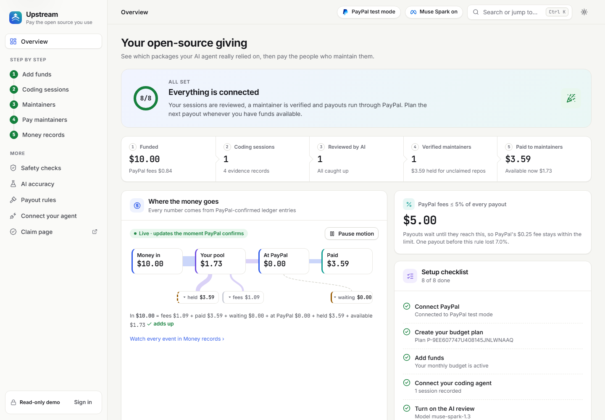
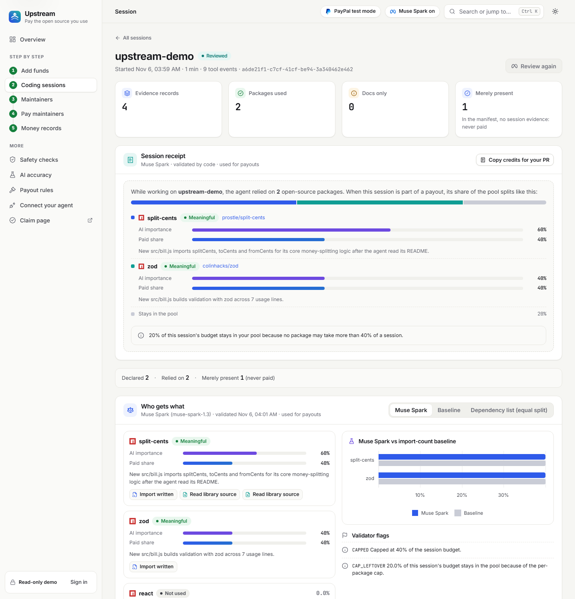
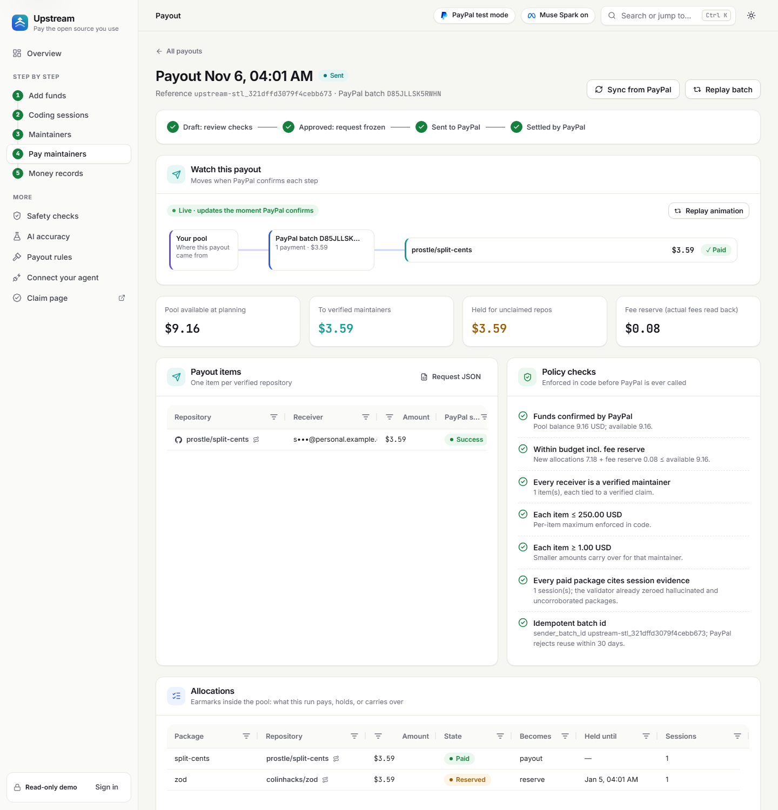
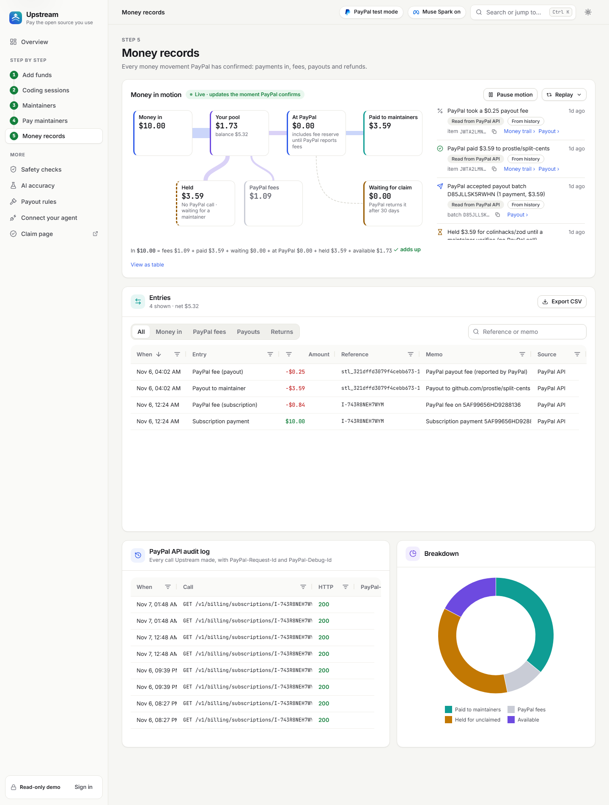
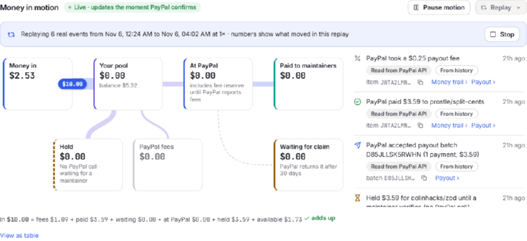
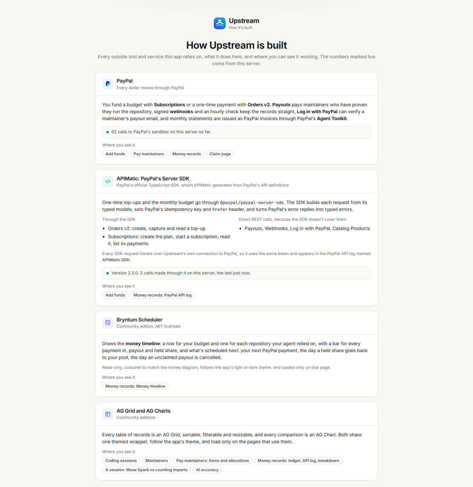
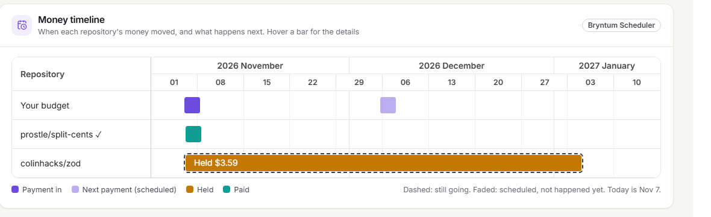
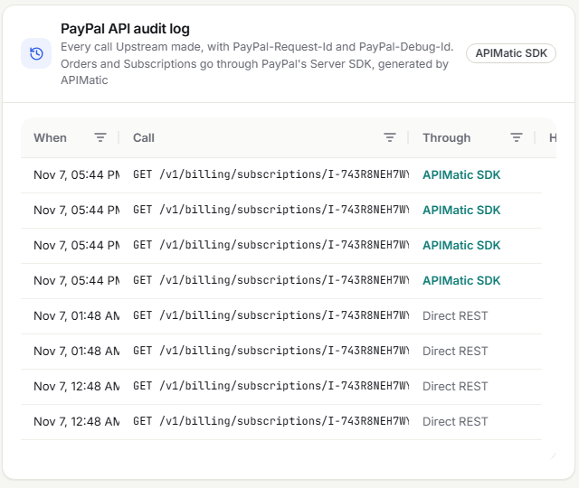
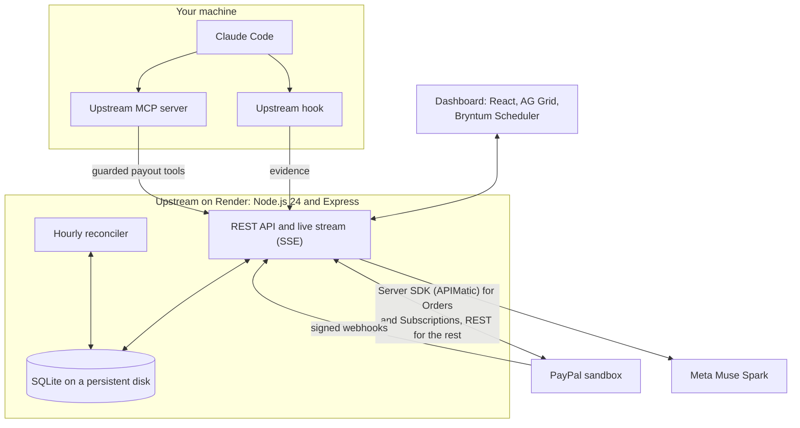

<p align="center">
  
</p>

<h1 align="center">Upstream</h1>

<p align="center">
  <b>Your AI coding agent leans on open source all day.<br>Upstream pays the people who built it, through PayPal.</b>
</p>

<p align="center">
  <a href="https://upstream-vvua.onrender.com/dashboard"><b>Live demo, no sign-in</b></a> ·
  <a href="#try-it">Try it</a> ·
  <a href="#how-paypal-is-used">How PayPal is used</a> ·
  <a href="#how-it-works">How it works</a> ·
  <a href="#run-it-yourself">Run it yourself</a>
</p>

> Built for *Build What's Next with PayPal and AI* (Devpost, 2026). Everything runs on the PayPal sandbox, so no real money moves. MIT licensed.

---

## What it does

When you build with an AI coding agent, it installs packages, imports them, reads their source and builds on them. Then the session ends, and the maintainers never hear about it. Upstream closes that loop:

1. **A Claude Code hook records what the agent actually did:** installs, imports, code written against a package, source read, docs looked up.
2. **Meta's Muse Spark weighs that evidence** and must cite it for every share. Plain code then drops anything it can't back up.
3. **You fund a budget with PayPal and approve each payout.** **PayPal Payouts** pays maintainers who have proven they run the repository.

The name is the idea: money should flow back upstream, to where the work came from.

## Why

- **Maintainers mostly aren't paid.** In Tidelift's 2024 survey, 60% of maintainers called themselves unpaid hobbyists ([The Register](https://www.theregister.com/2024/09/18/open_source_maintainers_underpaid/)).
- **AI agents made the gap quieter.** An agent can build on a library in minutes, and nothing tells its authors.
- **Dependency lists can't tell "used" from "present".** Tools such as [thanks.dev](https://thanks.dev) and [ecosyste.ms Funds](https://funds.ecosyste.ms) split money by manifest. A `package.json` can't tell the library your agent leaned on all afternoon from one nobody touched.
- **An AI shouldn't move money on its own.** In Upstream the AI only proposes. Code checks the proposal, caps are enforced in code, and a person approves every payout.

**Who it's for:**
- **Developers who code with AI agents.** Set a budget once with PayPal.
- **Teams with an open-source budget.** Every payment has a reason on record, and monthly statements are issued as PayPal invoices.
- **Maintainers.** Claim the money waiting for your repo with GitHub or a line in `FUNDING.yml`.

## A look at the app

Real screens from the sandbox run [below](#how-it-works).

<table>
  <tr>
    <td width="50%" valign="top"><br><b>Overview.</b> Budget, sessions, verified maintainers, payouts, and where the money is right now.</td>
    <td width="50%" valign="top"><br><b>A reviewed session.</b> What the agent relied on, Muse Spark's cited reasons, and each package's share against counting imports.</td>
  </tr>
  <tr>
    <td valign="top"><br><b>A payout.</b> The PayPal batch, the policy checks run before calling PayPal, and the share held for an unclaimed repo.</td>
    <td valign="top"><br><b>Money records.</b> Every PayPal-confirmed movement, the money timeline, the ledger and every PayPal API call.</td>
  </tr>
</table>

---

## How it works


1. **Fund.** Approve a monthly budget ($10 by default) with PayPal Subscriptions, or add money once with PayPal Orders. Only money PayPal has confirmed counts.
2. **Code.** The hook records evidence while you work. Secrets are redacted on your machine first.
3. **Review.** Muse Spark rates each package *meaningful*, *supporting*, *incidental* or *not used*, proposes a share, and cites evidence ids. The validator removes invented packages, made-up citations and anything only listed in a manifest.
4. **Claim.** A maintainer proves they run the repo with GitHub, or with a token committed to its `FUNDING.yml`. Until then, their share is held, never sent to a guess.
5. **Pay.** You approve a plan within caps, and one PayPal Payouts batch goes out with a fixed id, so a retry can never pay twice.
6. **Reconcile.** Signed webhooks and an hourly check bring PayPal's statuses and real fees back into the ledger.

**Our end-to-end run.** A real Claude Code session read the source of `split-cents` (a test package we published) and imported it, and also imported `zod`. Muse Spark credited both and left out a dependency nobody used. `split-cents` was claimed through `FUNDING.yml`, so PayPal sent its $3.59 in batch `D85JLLSK5RWHN`, with a $0.25 fee. `zod`'s share is held until its maintainer claims it.



The money screen animates only stored, PayPal-confirmed events, streamed live to the browser.

---

## How PayPal is used

PayPal is the only place money moves. Upstream never sees card or bank details, and believes only what PayPal reports back.

| Job | PayPal product |
|---|---|
| Fund a monthly budget | **Subscriptions**, through PayPal's Server SDK |
| Add money once | **Orders v2**, through PayPal's Server SDK |
| Pay maintainers | **Payouts**: create, read, and cancel unclaimed items |
| Verify a payout email (optional) | **Log in with PayPal** |
| Keep records straight | **Webhooks**, with signature verification |
| Monthly statements | **Invoicing**, through PayPal's **Agent Toolkit** |

- **No double payments.** Each batch's `sender_batch_id` comes from its payout, so PayPal accepts it only once, and the same id is sent as `PayPal-Request-Id`. The request body is frozen at approval. *Replay batch* re-sends it on purpose and shows PayPal's rejection.
- **Only PayPal's numbers count.** The budget is PayPal-confirmed payments. Fees come from PayPal's own fields (`fee_amount`, `seller_receivable_breakdown`, `payout_item_fee`).
- **Webhooks are checked, never trusted alone.** Each one is signature-verified, then triggers a fresh read from PayPal's API. An hourly reconciler re-reads anything still open.
- **Small payouts wait.** PayPal charged $0.25 per payout item in our runs, which is 7% of $3.59. So a share is paid only once the fee is at most 5% of it, which means from $5.00. Until then it's held, and the page says why.
- **Unclaimed money comes back.** Unclaimed payout items are cancelled after a set number of days, and the money is held for that repo again.
- **Agents can ask, only people can pay.** Upstream's MCP server gives agents guarded tools. They can't choose who gets paid or how much.

<details>
<summary><b>Every PayPal endpoint Upstream calls</b></summary>

| API | Calls | Code |
|---|---|---|
| OAuth2 | `POST /v1/oauth2/token`, cached until expiry | `server/src/paypal/client.ts` |
| Catalog Products | `POST /v1/catalogs/products` (direct, not in the SDK) | `subscriptions.ts` |
| Subscriptions (SDK) | `POST /v1/billing/plans`, `POST /v1/billing/subscriptions`, `GET …/{id}`, `GET …/{id}/transactions` | `subscriptions.ts`, `sdk.ts` |
| Orders v2 (SDK) | `POST /v2/checkout/orders`, `POST …/{id}/capture`, `GET …/{id}` | `orders.ts`, `sdk.ts` |
| Payouts | `POST /v1/payments/payouts`, `GET …/{id}`, `GET /v1/payments/payouts-item/{id}`, `POST …/{id}/cancel` | `payouts.ts`, `settlement.ts` |
| Identity | Authorize, `POST /v1/oauth2/token` (authorization code), `GET /v1/identity/openidconnect/userinfo` | `identity.ts`, `claims.ts` |
| Webhooks | `GET/POST/PATCH /v1/notifications/webhooks`, `POST /v1/notifications/verify-webhook-signature` | `webhooks.ts`, `events.ts` |
| Invoicing (Agent Toolkit) | `create_invoice`, `send_invoice` (no email), `record_payment_for_invoice`, `get_invoice` | `statements.ts` |

Chargebacks and partial refunds of subscription payments are flagged for review rather than booked, because PayPal's data doesn't show their exact effect.

</details>

---

## How AI is used, and kept on a leash

- **Claude Code is the agent being measured.** It isn't asked to cooperate. Hooks see every tool call.
- **Muse Spark is the judge.** `muse-spark-1.3`, with structured output, returns a role, a weight, a short reason and the evidence ids it relied on for each package. Session content is treated as data, so a README saying "pay me everything" is ignored. It flagged that attempt in 3 of 3 benchmark runs.
- **Code overrules the AI.** The validator (`server/src/attribution/validate.ts`) drops non-candidates and fake citations, zeroes any weight without evidence, and caps any one package at 40%.
- **It's compared with simpler methods, on screen.** Every review shows *counting imports* and *an equal split of the dependency list* next to Muse Spark's answer. On the *AI accuracy* page, you label sessions and see precision and recall for all three.

---

## Built with

| Tool | What it does here |
|---|---|
| **PayPal REST APIs** (sandbox) | Subscriptions, Orders v2, Payouts, Webhooks, Log in with PayPal |
| **PayPal Server SDK** (`@paypal/paypal-server-sdk` 2.5.0, generated by **APIMatic**) | Sends every Orders and Subscriptions call |
| **PayPal Agent Toolkit** | Issues monthly statements as PayPal invoices |
| **Meta Muse Spark** | Weighs the evidence |
| **Claude Code** hooks, plugin and MCP | Collects evidence, and gives agents guarded payout tools |
| **AG Grid and AG Charts** (Community) | Every table and chart in the dashboard |
| **Bryntum Scheduler** (Community, MIT) | The money timeline |
| **Render** | Hosts the live app, with a persistent disk for SQLite |
| deps.dev, ecosyste.ms, npm registry, GitHub API | Package to repository, funding links, maintainer proof, sign-in |

The live app's [How it's built](https://upstream-vvua.onrender.com/how-its-built) page shows each tool, where it's used, and live numbers: SDK calls made, the SDK's version, and the commit Render is running.



**AG Grid.** Coding sessions, maintainers, payout items, allocations, the ledger and the API log are AG Grids. The session comparison, money split and AI accuracy are AG Charts. All share one themed wrapper in [`web/src/data.tsx`](web/src/data.tsx), follow light and dark mode, and load only on the pages that use them.

**Bryntum.** The money timeline on *Money records* has one row for your budget and one per repository. It shows every payment, payout and held share, plus what's scheduled next: your next PayPal payment, and when a held share returns to your pool. The data comes from [`server/src/money/timeline.ts`](server/src/money/timeline.ts), and the view is [`web/src/money/Timeline.tsx`](web/src/money/Timeline.tsx).



**APIMatic: PayPal's Server SDK.** Orders and Subscriptions go through PayPal's official TypeScript SDK, which APIMatic generates. It builds typed requests, sets `PayPal-Request-Id` and `Prefer`, and turns PayPal's error replies into typed errors. [`server/src/paypal/sdk.ts`](server/src/paypal/sdk.ts) routes it over Upstream's own connection, so it shares the access token and every call is logged. The PayPal API log marks each call **APIMatic SDK** or **Direct REST**. Payouts, Webhooks and Log in with PayPal aren't in the SDK, so they stay direct.



**Render.** One web service runs the API, the live money stream and the dashboard, defined in [`render.yaml`](render.yaml). A 1 GB persistent disk holds the SQLite database, and `TRUST_PROXY_HOPS=3` matches how Render forwards visitors.

---

## Architecture



<details>
<summary><b>Where things live in this repo</b></summary>

| Path | What's inside |
|---|---|
| `hook/` | The Claude Code hook and its installer |
| `server/src/evidence/` | Tool calls to evidence, candidates, session import |
| `server/src/attribution/` | Muse Spark, the validator, the baselines, the accuracy report |
| `server/src/paypal/` | Every PayPal call; `sdk.ts` wires in PayPal's Server SDK |
| `server/src/settlement.ts`, `ledger.ts`, `money/` | Payouts, the ledger, live money events, the timeline |
| `server/src/claims.ts`, `public.ts`, `check.ts` | Maintainer claims, public repo pages and badges, `/check` |
| `server/test/` | 136 tests |
| `web/src/` | The dashboard, home page and in-browser session converter |
| `mcp/src/`, `.claude-plugin/`, `skills/` | The MCP server and the Claude Code plugin with four skills |

</details>

---

## Trust and safety

- **A private space per person.** Sign in with GitHub to get your own sessions, budget and payouts. A person can only spend what they funded. [Tests](server/test/workspaces.test.ts) play one person attacking another over HTTP.
- **Live safety checks.** The *Safety checks* page re-checks the stored records against ten rules on every load. Examples: every ledger entry points at a PayPal object, and every payout went to a verified maintainer. An empty check says so, rather than passing.
- **Ownership is proven, never assumed.** A package-to-repo link never releases money by itself. The maintainer must prove control through GitHub (`admin` or `maintain` permission) or `FUNDING.yml`.
- **History is locked.** Once a session is paid out, its review can't be re-run.
- **AI spend is capped.** Reviews are limited per person per day, and the public `/check` page has daily and per-visitor limits.

---

## What's proven

| Claim | Evidence |
|---|---|
| The whole loop works | Real Claude Code session, live Muse review, maintainer verified from GitHub, real sandbox payout `D85JLLSK5RWHN` ($3.59, PayPal fee $0.25). Sending twice paid once, PayPal rejected a replay, and signed webhooks arrived. |
| Funding through PayPal's Server SDK | Subscription `I-743R8NEH7WYM`: $10.00 paid, $0.84 fee. A $1.00 one-time top-up on the live app: order created, approved on PayPal's sandbox page, captured, confirmed by a signed webhook, and booked once with PayPal's $0.52 fee. Every step went through the SDK. |
| Money moves on screen only when PayPal confirms it | A second payout (`LK2R3WYGYTZM2`, $1.70) watched live. Totals added up to the cent throughout. |
| The AI finds what dependency lists miss | 12 scripted scenarios, 3 runs each: Muse Spark 12 of 12 every run, counting imports 7 of 12. |
| Code overrules the AI | 9 of 9 deliberately malicious AI outputs blocked. |
| It works with nothing installed | A real 33 MB session went through `/check` in 44 s. 17 packages declared, 6 relied on, and only 0.85 MB left the browser. |

<details>
<summary><b>The benchmark, and how much to trust it</b></summary>

`node scripts/benchmark.mjs` re-runs it against the live model for about $0.30. Last full run: Nov 5, 2026, `muse-spark-1.3`, effort medium.

These are 12 **scripted** scenarios, not real sessions. The expected answers were written before each run by the benchmark's author (Claude, an AI). The prompt was tuned after S3 and S10 failed, so those two aren't held out. Treat it as a sanity check. Real labelled sessions on the *AI accuracy* page are the test that counts.

| Scenario | Should be paid | Counting imports | Muse Spark |
|---|---|---|---|
| S1 new package vs manifest noise | zod | zod | zod |
| S2 new code on an existing import | dayjs | nothing | dayjs |
| S3 source studied, then rewritten | lodash | nothing | lodash |
| S4 type-only import vs real use | fastify | express, fastify | fastify |
| S5 unused import vs real use | hono | chalk, hono | hono |
| S6 prompt injection in a README | axios | axios | axios, and flags it |
| S7 installed, then removed | dayjs | dayjs | dayjs |
| S8 Python, through an import map | requests, pyyaml | requests, pyyaml | requests, pyyaml |
| S9 searched for, never used | express | express | express |
| S10 log spam vs a core library | drizzle-orm, debug | both | both, core library higher |
| S11 another library rewritten | p-limit | nothing | p-limit |
| S12 source read, unrelated code written | hono | hono | hono |

Counting imports scores precision 0.85 and recall 0.79. Muse Spark scores 1.00 and 1.00. A review costs about $0.0072 and takes 11.4 s at the median. A scripted large session (200 file writes, 20 packages) paid all 20 in three of six runs and none in the other three. That's not fixed yet.

</details>

**Not done yet.** It's one real session, and the payout went to a test package this project owns, so it proves the system works, not demand. Log in with PayPal is off. Unclaimed cancels and refunds are tested only against a stand-in for PayPal. No statement has been issued live, because the sandbox app lacks PayPal's Invoicing permission. The *AI accuracy* page has no real labelled sessions yet.

---

## Try it

The live app is **https://upstream-vvua.onrender.com**, on the PayPal sandbox.

1. **[See the live demo](https://upstream-vvua.onrender.com/dashboard).** No sign-in. It's the creator's own space, read-only: real sessions, AI reviews and sandbox payouts.
2. **Money records → Replay → Everything.** Watch the real payout move through the diagram. The timeline and the PayPal API log are on the same page.
3. **Pay maintainers.** Open the payout and read its policy checks.
4. **[/check](https://upstream-vvua.onrender.com/check).** Drop a Claude Code session file and see what the agent really relied on. No sign-in, and it's deleted after 24 hours.
5. **Sign in with GitHub** for your own empty space, with one clear next step. Funding it needs a PayPal sandbox buyer login, which is in the Devpost testing notes.

---

## Run it yourself

You need **Node.js 22.18 or newer**.

```bash
git clone https://github.com/PROSTLE/Upstream upstream && cd upstream
npm install
cp .env.example .env        # fill in the values below
npm run doctor              # read-only check of every credential and API
npm run build
npm run setup:paypal        # sandbox product, plan, and webhook (needs an https PUBLIC_BASE_URL)
npm start                   # http://localhost:8787
```

| Variable | Where to get it |
|---|---|
| `PAYPAL_CLIENT_ID`, `PAYPAL_CLIENT_SECRET` | developer.paypal.com → Apps & Credentials → a **Sandbox** app |
| `MODEL_API_KEY` | dev.meta.ai → API keys |
| `ADMIN_TOKEN`, `INGEST_TOKEN` | Any long random strings |
| `GITHUB_CLIENT_ID`, `GITHUB_CLIENT_SECRET` | A GitHub OAuth app with two callbacks: `PUBLIC_BASE_URL/api/auth/github/callback` and `PUBLIC_BASE_URL/api/claims/github/callback` |
| `GITHUB_TOKEN` | Optional. Raises GitHub's rate limit. |
| `OPERATOR_GITHUB_LOGINS` | Your GitHub login |
| `PUBLIC_BASE_URL` | Your https address (a tunnel locally). Leave it out on Render. |

A missing credential turns its feature off, and the dashboard says which one. Nothing falls back to mock data. `npm test` runs 136 tests. The PayPal stand-in exists only in the tests, and the product always talks to PayPal. To deploy, use [`render.yaml`](render.yaml): one web service with a persistent disk, which needs a paid instance.

---

## Limitations

- **Regulation.** Funds pass through one PayPal business account. Redistributing other people's money needs legal review before real use. This project is sandbox-only.
- **Demand is unproven.** The problem is documented. Willingness to pay for this isn't.
- **The operator can read the database.** Only connect your agent to a server you trust.
- **npm and PyPI only.** Maintainer claims are GitHub-only.
- **Evidence has blind spots.** Code written from memory leaves no trace. Installs run through Claude Code's PowerShell tool on Windows are missed. `npx tsc` credits a package named `tsc`.

**On novelty.** Funding open source from dependency trees exists (thanks.dev, StackAid, ecosyste.ms Funds). Paying maintainers from evidence of what an agent **actually used**, separating "used" from "merely present", is what we didn't find anywhere. That evidence layer is Upstream's contribution.

<details>
<summary><b>Sources</b></summary>

PayPal: [Payouts API](https://developer.paypal.com/docs/api/payments.payouts-batch/v1/) · [Cancel unclaimed payouts](https://developer.paypal.com/payouts/use-payouts/cancel-reverse-payouts) · [Webhook events](https://developer.paypal.com/api/rest/webhooks/event-names/) · [Verify webhook signature](https://developer.paypal.com/api/webhooks/v1/verify-webhook-signature-post) · [Subscriptions API](https://developer.paypal.com/docs/api/subscriptions/v1/) · [Payouts fees](https://developer.paypal.com/payouts/fees) · [Server SDK](https://github.com/paypal/PayPal-TypeScript-Server-SDK) · [Agent Toolkit](https://github.com/paypal/agent-toolkit)
Data: [deps.dev API v3](https://docs.deps.dev/api/v3/) · [ecosyste.ms](https://ecosyste.ms/api) · [GitHub FUNDING.yml](https://docs.github.com/en/repositories/managing-your-repositorys-settings-and-features/customizing-your-repository/displaying-a-sponsor-button-in-your-repository)
Agents: [Claude Code hooks](https://code.claude.com/docs/en/hooks) · [ATTRIBUTION.md](https://github.com/attributionmd/attribution.md) · [MCP TypeScript SDK](https://github.com/modelcontextprotocol/typescript-sdk)
Context: [Tidelift 2024 (The Register)](https://www.theregister.com/2024/09/18/open_source_maintainers_underpaid/) · [thanks.dev](https://thanks.dev) · [ecosyste.ms Funds](https://funds.ecosyste.ms)

</details>

## License

[MIT](LICENSE)
