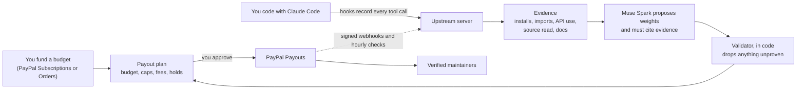
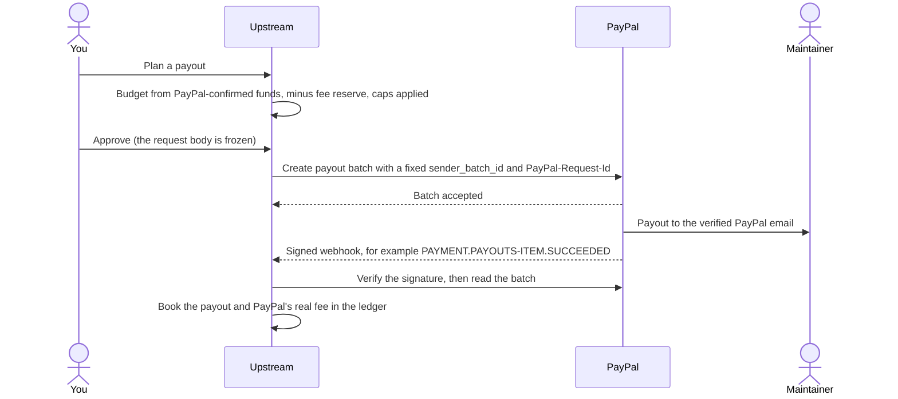
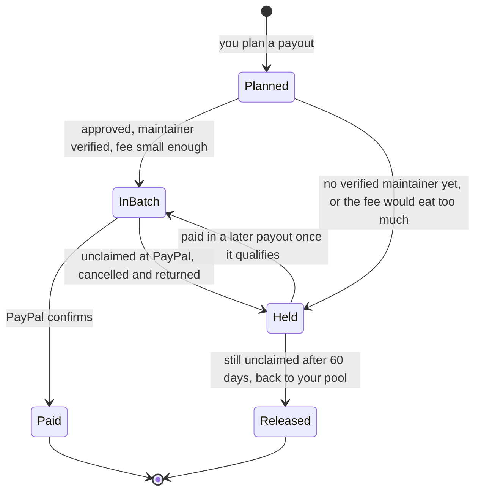
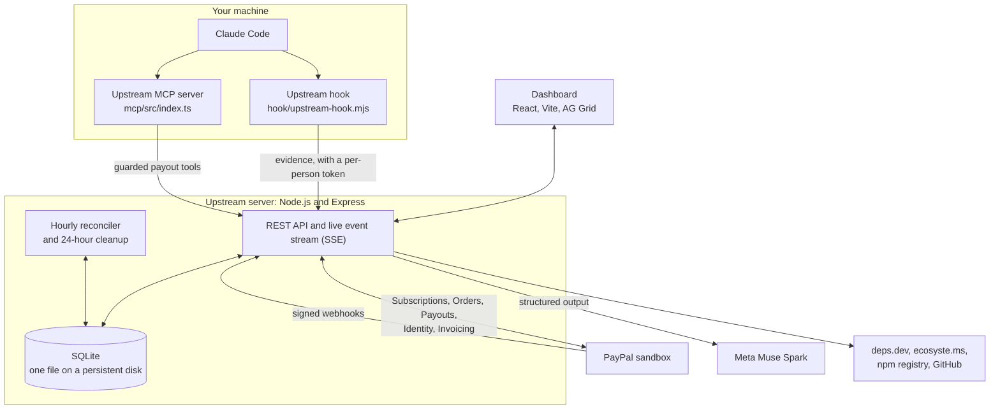

<p align="center">
  
</p>

<h1 align="center">Upstream</h1>

<p align="center">
  <b>Your AI coding agent leans on open source all day.<br>Upstream pays the people who built it, through PayPal.</b>
</p>

<p align="center">
  <a href="https://upstream-vvua.onrender.com"><b>Live app</b></a> ·
  <a href="#try-it-in-two-minutes">Try it in two minutes</a> ·
  <a href="#how-paypal-is-used">How PayPal is used</a> ·
  <a href="#how-it-works">How it works</a> ·
  <a href="#run-it-yourself">Run it yourself</a>
</p>

> Built for *Build What's Next with PayPal and AI* (Devpost, 2026). Everything runs on the PayPal sandbox, so no real money moves. MIT licensed. First commit: Oct 11, 2026.

---

## The short version

When you build something with an AI coding agent, the agent doesn't write it from nothing. It installs packages, imports them, reads their source code, looks up their docs, and quietly builds your feature on top of years of other people's unpaid work. Then the session ends, and nobody upstream ever hears about it.

Upstream closes that loop. A small hook watches what your agent **actually did** during a session: which packages it installed, which ones it wrote code against, whose source it studied. An AI model, Meta's Muse Spark, weighs that evidence and has to cite it. Then plain code throws out anything it can't back up. You set a budget with PayPal, you approve every payout yourself, and **PayPal Payouts** sends the money to maintainers who have proven they run the repository.

The name is the idea. Money should flow back upstream, to where the work came from. The logo is a salmon doing exactly that.

### Contents

- [Why we built it](#why-we-built-it)
- [Who it's for](#who-its-for)
- [How it works](#how-it-works), with the big picture, one session from start to finish, and where the money is at any moment
- [How PayPal is used](#how-paypal-is-used)
- [How AI is used, and kept on a leash](#how-ai-is-used-and-kept-on-a-leash)
- [The evidence layer](#the-evidence-layer)
- [Architecture](#architecture)
- [Trust and safety](#trust-and-safety)
- [What's proven so far](#whats-proven-so-far), including the benchmark
- [Try it in two minutes](#try-it-in-two-minutes)
- [Run it yourself](#run-it-yourself)
- [Tools used](#tools-used), [limitations](#limitations-stated-plainly) and [sources](#sources)

---

## Why we built it

**1. Maintainers do the work, and mostly don't get paid.** In Tidelift's 2024 maintainer survey, **60%** of maintainers described themselves as *unpaid hobbyists*, and **47%** said they are *unpaid for their work*. Tidelift puts the gap down to wording, because some "hobbyists" receive token amounts. ([The Register](https://www.theregister.com/2024/09/18/open_source_maintainers_underpaid/), [Tidelift press release](https://www.businesswire.com/news/home/20240917030299/en/))

**2. AI coding agents made the gap bigger and quieter.** An agent can pull in a library, study its internals and build on it in minutes. That is real value, created on someone else's work, and there is no feedback loop at all. The well-known infrastructure costs, such as Read the Docs' 73 TB month and Fedora blocking a whole country, come from *training crawlers*, not coding agents. We mention them only as context and don't claim coding agents caused them.

**3. Today's funding tools can't tell "used" from "merely present".** Tools that split money across your dependencies ([thanks.dev](https://thanks.dev), [ecosyste.ms Funds](https://funds.ecosyste.ms), and earlier [StackAid](https://itsfoss.com/news/stackaid-beta/)) work from dependency manifests. A `package.json` can't tell the library your agent leaned on all afternoon from one nobody has touched in a year.

**4. Nobody should let an AI move money on its own.** "Let the AI decide who gets paid" is a scary sentence. So in Upstream the AI only *proposes*. Code checks every proposal against stored evidence, policy caps are enforced in code, and a person approves every payout on the way out.

## Who it's for

| Who | What they get |
|---|---|
| **Developers who code with AI agents** | An honest, low-effort way to give back to the projects their agent actually used, from a budget they set once with PayPal. |
| **Teams and companies with an open-source budget** | A reason on record for every payment: the session, the evidence and the AI's cited rationale. Monthly statements are issued as PayPal invoices. This is the strongest long-term fit: a company running its own copy with its own PayPal account. |
| **Open-source maintainers** | Money that waits for them until they claim it with GitHub or a line in `FUNDING.yml`, a public page and README badge showing what's waiting, and PayPal transaction ids they can find in their own PayPal activity. |
| **Anyone curious** | The `/check` page: drop a Claude Code session file and see what your agent really relied on, with no sign-in. |

---

## How it works

### The big picture



### One session, from start to finish

1. **Fund it.** You approve a monthly "agent tithe" ($10 by default) with **PayPal Subscriptions**, or add money once with **PayPal Orders**. Only money PayPal has confirmed counts toward your budget, and PayPal's own fee numbers are recorded with it.
2. **Code as usual.** The Upstream hook runs inside Claude Code and records every install, import, API call, source read and docs lookup. Secrets are redacted on your machine before anything is sent.
3. **Review the session.** Muse Spark sorts each package into *meaningful*, *supporting*, *incidental* or *not used*, proposes a share, and cites the evidence ids behind each one. Then the validator, which is plain code, removes invented packages, made-up citations and anything that was merely listed in a manifest.
4. **Maintainers claim their repos.** A maintainer proves they run the repository through GitHub, or by committing a token to the repo's `FUNDING.yml`, and registers a PayPal email. Until then, their share is **held**, never sent to a guess.
5. **Plan and approve.** Upstream plans a payout from your PayPal-confirmed balance, minus a fee reserve, within per-package and per-payout caps. You read the plan and its policy checks, then approve it.
6. **Pay.** One **PayPal Payouts** batch goes out, with a fixed batch id, so a retry can never pay twice.
7. **Reconcile.** Signature-verified webhooks and an hourly reconciler bring every status back from PayPal: sent, fees, unclaimed, returned. Every movement lands in a ledger tied to a PayPal object.

**In our own end-to-end run** on the sandbox, the agent read the source of `split-cents` (a small test package we published for this) and imported it, and also imported `zod`. Muse Spark credited both and left out a dependency nobody used. `split-cents` was claimed through `FUNDING.yml`, so PayPal sent its $3.59 in batch `D85JLLSK5RWHN`, with a $0.25 fee. `zod`'s share is still held, waiting for its maintainer to claim it.

### A payout, step by step



### Where the money is at any moment



Nothing on the *Money records* page is simulated. It animates only stored events: ledger rows PayPal confirmed, PayPal's reply accepting a batch, payout status changes, and Upstream's own holds, which are always labelled *No PayPal call*. Each event says whether a signature-verified webhook or a read from PayPal's API confirmed it.


*A replay of the real sandbox run above: batch `D85JLLSK5RWHN`, $3.59.*

Events reach your browser live over Server-Sent Events. If streaming fails, the page polls every 5 seconds and says so. It follows your system's reduced-motion setting, and works by keyboard and screen reader.

---

## How PayPal is used

PayPal is the only place money moves. Upstream never holds card details or bank data. It asks PayPal to move money and then believes only what PayPal reports back.

| Job | PayPal product | What Upstream does with it |
|---|---|---|
| Fund a monthly budget | **Subscriptions** (catalog product, plan, subscription, transactions) | You approve the "agent tithe" on PayPal's own page. Upstream reads the subscription's transactions to book each payment and its fee. |
| Add money once | **Orders v2** (create, capture, read) | A one-time top-up, captured on the server when you return from PayPal. Gross and fee come from the capture's `seller_receivable_breakdown`. |
| Pay maintainers | **Payouts** (create batch, show batch, show item, cancel unclaimed item) | One batch per approved plan, to verified maintainers only. |
| Verify a payout email | **Log in with PayPal** (Identity) | Optional: maintainers connect their PayPal account, so the email is one PayPal has verified. Upstream doesn't keep their PayPal token. |
| Keep records straight | **Webhooks** (create, update, `verify-webhook-signature`) | Every event is signature-checked, stored and processed once. |
| Monthly statements | **Invoicing**, through **PayPal's Agent Toolkit** | Turns a month of funding into a PayPal invoice marked as paid, with one line per payment. |
| Sign in to PayPal's API | **OAuth2** client credentials | Tokens are cached until they expire. |

**The details that matter**

- **No double payments.** Every batch uses `sender_batch_id = upstream-<settlement id>`. PayPal completes a payment only once per `sender_batch_id` and rejects reuse within 30 days, so a retry after a server error is safe. The request body is frozen when you approve, and the same id is sent as `PayPal-Request-Id`. **Replay batch** re-sends the identical body on purpose and shows PayPal's real rejection.
- **Unclaimed money comes back.** PayPal returns unclaimed payouts after 30 days unless they're cancelled. Upstream cancels `UNCLAIMED` items after `POLICY_CANCEL_UNCLAIMED_AFTER_DAYS` (or when you ask), books the return, holds the money for that repo again, and flags the claim so the maintainer can fix their email.
- **Fees are PayPal's real numbers.** Funding fees come from the subscription transaction's `fee_amount`, and payout fees from each item's `payout_item_fee`. A fee reserve keeps the budget safe until PayPal reports the actual fee.
- **Small payouts wait instead of being eaten by fees.** PayPal charges per payout item. In our own sandbox payouts it reported a $0.25 fee on both $3.59 and $1.70, which is 7% and 15%. So a payout only goes out once the fee is at most `POLICY_MAX_FEE_SHARE` of it, 5% by default, which means payouts start at $5.00. Smaller shares are held for the maintainer, and the page says why, for example: *$2.10 held · paying now would lose 12% to PayPal's $0.25 fee · pays out at $5.00*. PayPal's [fee docs](https://developer.paypal.com/payouts/fees) say fees vary by country and payout type.
- **Webhooks never move money directly.** Funding events trigger a fresh read of PayPal's transaction list, so there is one source of truth. Batch events trigger a batch read. Refunds and reversals trigger the same pull. `CHECKOUT.ORDER.APPROVED` captures a top-up whose payer closed the tab. An hourly reconciler re-reads open batches, subscriptions and recent top-ups, so nothing depends on a webhook arriving.
- **Statements through the Agent Toolkit.** *Issue statement* calls `create_invoice` with one line per payment and its PayPal transaction id, then `send_invoice` with `send_to_recipient: false` so nobody gets an email, then `record_payment_for_invoice` for each payment, then `get_invoice`. Issuing again returns the same invoice. The note can be written by Muse Spark, but code checks that every number in it is on the statement.
- **Agents can ask, but only people can pay.** PayPal's Agent Toolkit has no Payouts tool, so Upstream's MCP server adds guarded ones. The model can never choose receivers or amounts, can only send a batch a person approved, and a funding request only returns a PayPal link that the person approves, capped per 24 hours by `POLICY_MAX_AGENT_TOPUP` (off when unset).

<details>
<summary><b>Every PayPal endpoint Upstream calls</b></summary>

| API | Calls | Where |
|---|---|---|
| OAuth2 | `POST /v1/oauth2/token` (cached until expiry) | `server/src/paypal/client.ts` |
| Catalog Products | `POST /v1/catalogs/products` | `server/src/paypal/subscriptions.ts` |
| Subscriptions | `POST /v1/billing/plans`, `POST /v1/billing/subscriptions` (approve link), `GET /v1/billing/subscriptions/{id}`, `GET …/{id}/transactions` | `subscriptions.ts`, `funding.ts` |
| Payouts | `POST /v1/payments/payouts`, `GET /v1/payments/payouts/{id}` (all pages), `GET /v1/payments/payouts-item/{id}`, `POST /v1/payments/payouts-item/{id}/cancel` | `payouts.ts`, `settlement.ts` |
| Orders v2 | `POST /v2/checkout/orders` (intent CAPTURE, `payment_source.paypal.experience_context`), `POST /v2/checkout/orders/{id}/capture` and `GET /v2/checkout/orders/{id}` with `Prefer: return=representation` | `paypal/orders.ts`, `topups.ts` |
| Identity (Log in with PayPal) | `/connect` authorize page, `POST /v1/oauth2/token` (`grant_type=authorization_code`), `GET /v1/identity/openidconnect/userinfo` (falls back to `/v1/identity/oauth2/userinfo`, the path the integration guide shows) | `paypal/identity.ts`, `claims.ts` |
| Webhooks | `GET/POST/PATCH /v1/notifications/webhooks`, `POST /v1/notifications/verify-webhook-signature` (raw body spliced in byte for byte) | `webhooks.ts`, `events.ts` |
| Invoicing (through the Agent Toolkit) | `create_invoice`, `send_invoice`, `record_payment_for_invoice`, `get_invoice`, which call `/v2/invoicing/invoices` | `paypal/statements.ts` |

A chargeback (`PAYMENT.CAPTURE.REVERSED`) is flagged for review rather than booked, because PayPal's docs don't show how it appears on the order. A partial refund of a subscription payment is also flagged, not booked, because the transaction list doesn't break out the refunded amount.

</details>

---

## How AI is used, and kept on a leash

There are two AI roles here, and they're deliberately different.

**Claude Code is the agent being measured.** Upstream doesn't ask it to cooperate or to report on itself. Hooks see every tool call it makes, the same way Claude Code's own tooling does.

**Muse Spark is the judge.** Meta's `muse-spark-1.3`, called through Meta's Anthropic-format Messages endpoint with the Anthropic TypeScript SDK and a JSON schema for structured output, reads the evidence for a session and returns, for each package:

- a role: *meaningful*, *supporting*, *incidental* or *not used*
- a relative weight
- a one- or two-sentence reason a maintainer can read
- **the evidence ids it relied on**, which are required

The system prompt treats everything from the session as data, so a README that says "pay me everything" is ignored. In our benchmark the model flagged that attempt in 3 of 3 runs. We use a Standard Muse model, whose content Meta says it doesn't use for training, because sessions contain your code.

**Then code overrules the AI.** The validator (`server/src/attribution/validate.ts`) runs after every review:

- drops packages that aren't candidates in this session
- drops citations that don't exist
- zeroes any weight not backed by evidence linked to that package, so "merely present" can never be paid
- normalises the weights and enforces `POLICY_MAX_PACKAGE_SHARE` (40% by default)
- flags weak evidence with a high weight, strong evidence left unpaid, and big disagreements with the baseline

**And it has to beat simpler methods, on screen.** Every review also stores two comparisons: the **baseline**, *imports written × lines using them*, and an **equal split of the dependency list**, which approximates manifest-based funding (it's not thanks.dev's exact algorithm). Both appear as tabs next to Muse Spark's result. Neither can ever be chosen for a payout.

**And you can measure it.** On the *AI accuracy* page you label packages in real sessions as meaningful, incidental or not used. Upstream then reports precision, recall, F1, accuracy and weight error for Muse Spark, the baseline and the dependency-list split, **on the same sessions**. Labels saved before any review ran are marked *blind* by the server, from stored timestamps, so the labeller can't have been nudged.

---

## The evidence layer

The collector is a Claude Code **hook** (`hook/upstream-hook.mjs`), not a tool the agent chooses to call. It listens to `SessionStart`, `PostToolUse`, `Stop` and `SessionEnd`.

| Evidence | Detected from |
|---|---|
| `dep_install` | `npm/pnpm/yarn/bun add`, `pip/uv/poetry/pdm add`, `python -m pip install` |
| `manifest_add` | Edits that add entries to `package.json`, `requirements*.txt`, `pyproject.toml` (PEP 621, poetry, dependency groups) |
| `import_added` | New `import`/`require`/`from … import` in written code, with the number of added lines that use those bindings. Type-only imports are weak. |
| `api_usage` | New code using a package already imported in that file. The hook attaches the file's first 8 KB. |
| `cli_run` | `npx`, `bunx`, `pnpm dlx`, `uvx`, `pipx run` |
| `logic_reused` | After reading a package's source, the agent wrote its own code declaring the same names. It catches rewritten logic that no import reveals. A coincidental name can fool it, so the review judges it. |
| `source_read` / `source_search` | Read/Grep/Glob inside `node_modules/<pkg>` or `site-packages/<module>`. A short excerpt is kept for `logic_reused` to compare against. |
| `docs_fetch` | WebFetch URLs: npmjs.com, pypi.org, GitHub, unpkg, jsDelivr, or a host matching the package's resolved homepage or docs |
| `docs_mcp` | Context7 `resolve-library-id` / `query-docs` calls |
| `web_search` | The package name appearing in a search query (weak) |

Python import names are mapped to distributions (`yaml` to PyYAML, `PIL` to pillow) on your machine with `importlib.metadata.packages_distributions()`, using the project's `.venv` when there is one. The map is cached per interpreter, and the current directory is removed from `sys.path` first, so a project file such as `json.py` never runs inside the hook. Manifests are snapshotted at `SessionStart` and `Stop`, so "added this session" is a diff, not a guess.

**Privacy.** Files that look like secrets (`.env*`, keys, credentials, `.npmrc`, `.pypirc`) are redacted before anything leaves your machine. Reads of your own files send only the path. Events go only to the server you configure, and are spooled locally while it's offline.

**No install needed to try it.** Every Claude Code user already has months of sessions on disk (`~/.claude/projects/<project>/`, or `%USERPROFILE%\.claude\projects\<project>\` on Windows). The `/check` page converts a session file **in your browser** and sends only what the review needs: code the agent wrote, commands it ran, dependency files it read, and the first 8 KB of source files it edited. Signed-in users can also *Import past sessions* into their private space. Importing is safe to repeat, because events dedupe by tool-call id.

---

## Architecture



**The stack, and why it's small on purpose**

- **Node.js 24** with built-in SQLite (`node:sqlite`) and TypeScript type stripping, so there's no database server, no native build and no compile step for the server.
- **Express 5** for the API, including Server-Sent Events for the live money stream.
- **SQLite**, one file. Every person's records live in the same database and are kept apart by checks on every route.
- **React 19, Vite, React Router, AG Grid and AG Charts** for the dashboard.
- **Hosted on Render**: one web service with a 1 GB persistent disk, defined in `render.yaml`.

**Where things live in this repo**

| Path | What's inside |
|---|---|
| `hook/` | The Claude Code hook, its `hooks.json` and the installer |
| `server/src/evidence/` | Turning tool calls into evidence, building candidates, importing session files |
| `server/src/attribution/` | The Muse Spark call, the validator, the baseline, the dependency-list split and the accuracy report |
| `server/src/paypal/` | Every PayPal call: OAuth, subscriptions, orders, payouts, identity, webhooks, statements |
| `server/src/settlement.ts`, `ledger.ts`, `money/` | Planning, approving and sending payouts, the ledger, and the live money events |
| `server/src/claims.ts`, `public.ts`, `check.ts` | Maintainer claims, public repo pages and badges, and the `/check` page |
| `server/src/audit.ts`, `auth.ts`, `users.ts` | The live safety checks, Sign in with GitHub, and private spaces |
| `server/src/resolve/` | Package to repository, through deps.dev, ecosyste.ms and the npm registry |
| `server/test/` | 128 tests, including one person attacking another over HTTP |
| `web/src/` | The dashboard, the home page and the in-browser session converter |
| `mcp/src/` | The MCP server that gives agents guarded payout tools |
| `.claude-plugin/`, `skills/` | The Claude Code plugin: hooks, MCP server and four skills (`/credits`, `/fund`, `/receipt`, `/statement`). The `SKILL.md` files are part of the plugin, which is why they're the only other Markdown files here. |
| `scripts/` | The dev runner, the icon renderer, the benchmark and the `/check` sample builder |

---

## Trust and safety

You shouldn't have to take any of this on faith, so the app checks itself in public.

- **A private space for each person.** Anyone can sign in with GitHub and gets their own sessions, budget, money records, payouts, safety checks and agent token. Other people's records answer "not found", a person can only spend money they funded, and hourly reconciliation books each payment to its owner. [`server/test/workspaces.test.ts`](server/test/workspaces.test.ts) plays one person attacking another over HTTP. Packages and maintainer claims are shared, so a maintainer verifies once for everyone.
- **Live safety checks.** The *Safety checks* page (`GET /api/audit`) re-reads the stored records on every request, against ten rules. Every ledger entry points at a PayPal object. Held plus in-flight money is covered by the PayPal-confirmed balance. Every payout went to a maintainer verified before approval, with stored proof. Each item equals its allocations to the cent. The ledger agrees with each item's PayPal status. Items respect the caps recorded with their run. Only signature-verified webhooks changed anything. Every paid share cites evidence that exists. Every allocation traces to sessions whose review pays that package. Unfinished batches were re-read from PayPal in the last 2 hours. A check with nothing to examine says *nothing to check yet*, never a pass. [`server/test/audit.test.ts`](server/test/audit.test.ts) alters one record at a time and expects the matching check to fail.
- **Ownership is proven, never assumed.** deps.dev itself notes that its package-to-repo links "are not verified for correctness", so a link alone never releases money. A repo becomes payable only when a maintainer proves control: GitHub OAuth showing `admin` or `maintain` permission, or a token they commit to the repo's `FUNDING.yml`.
- **History is locked.** Once a session is in a payout, its review can't be re-run or swapped, so the money trail can't be rewritten after the fact.
- **The AI review costs money, so it's capped.** Each person other than the operator gets `POLICY_MAX_REVIEWS_PER_DAY` reviews. The public `/check` page has a daily cap and a per-visitor hourly limit. Over either one, you still get the deterministic methods, and the page says the AI review is paused.
- **Maintainers can follow the money.** `/r/owner/name` and a README badge (`/api/badge/owner/name.svg`) show what agents relied on and what's held, in flight or paid, plus each payout PayPal reported, with its transaction id. *Invite* on the Maintainers page writes a GitHub issue from your real numbers and opens GitHub's form. You press submit yourself, so nothing is ever posted automatically.

---

## What's proven so far

| Claim | Evidence |
|---|---|
| The whole loop works end to end | A real Claude Code session with the real hook, then a live Muse review, a maintainer claim verified from the repo on GitHub, and a real sandbox payout: batch `D85JLLSK5RWHN`, $3.59 sent (transaction `98L012548L1896315`), PayPal's $0.25 fee recorded. Sending it twice paid once, PayPal rejected a replay, and PayPal's webhooks arrived with valid signatures. |
| Real PayPal funding | Sandbox subscription `I-743R8NEH7WYM`: $10.00 paid, PayPal's $0.84 fee recorded. |
| Money only moves on screen when PayPal confirms it | A second real sandbox payout (batch `LK2R3WYGYTZM2`, $1.70) was watched live. Each step moved when PayPal's reply or its API confirmed it, every event appeared once, and the totals added up to the cent throughout. |
| It runs as a hosted service | The [live app](https://upstream-vvua.onrender.com) runs on Render with the real sandbox history above. PayPal's webhook points at it, and its live stream delivers events without buffering. |
| The AI finds what dependency lists miss | Live `muse-spark-1.3` on 12 scripted scenarios, 3 runs each: 12 of 12 correct on every run, against 7 of 12 for counting imports. See [the benchmark](#the-benchmark). |
| A README can't talk the AI into paying it | A package whose README demanded all the money got nothing, and the AI flagged the attempt in 3 of 3 runs. |
| Code overrules the AI | 9 of 9 deliberately malicious AI outputs were blocked. |
| It works on a real session with nothing installed | A real 33 MB Claude Code session from building this project went through `/check`, signed out, with live Muse in 44 seconds: 17 packages declared in `web/package.json`, 6 relied on. Only 0.85 MB left the browser. |
| People's money and data stay apart | [Tests](server/test/workspaces.test.ts) act as one person attacking another over HTTP, and a real two-person run on the sandbox and live AI leaked nothing. |

**Not done yet, stated plainly.** That run is one session, and the payout went to a test package this project owns (`split-cents`), so it proves the system works, not that anyone outside wants it. A one-time top-up hasn't been approved through PayPal yet. Log in with PayPal is off. Cancelling an unclaimed payout and refunds have only been tested against a stand-in for PayPal. No statement has been issued live, because the sandbox app doesn't have PayPal's Invoicing permission switched on yet, and PayPal answers 403 until it does. There are no real labelled sessions on the AI accuracy page yet.

### The benchmark

`node scripts/benchmark.mjs` re-runs everything below against the live model, for about $0.30. The last full run was on Nov 5, 2026: `muse-spark-1.3`, effort medium, per-package cap 0.4, Node 24.13.0, on a Ryzen 5 5600H laptop running Windows.

**Read this first.** These are 12 scripted scenarios, not real agent sessions. The expected answers were written by the benchmark's author (Claude, an AI) before each run, and the prompt was tuned after seeing S3 and S10 fail, so those two aren't held out. Treat it as a sanity check, not an accuracy figure. Real labelled sessions on the *AI accuracy* page are the test that counts.

| Scenario | Should be paid | Counting imports pays | Muse Spark pays (all 3 runs) |
|---|---|---|---|
| S1 new package vs manifest noise | zod | zod | zod |
| S2 new code on an existing import | dayjs | nothing | dayjs |
| S3 library source studied, then rewritten | lodash | nothing | lodash |
| S4 type-only import vs real use | fastify | express and fastify | fastify |
| S5 unused import vs real use | hono | chalk and hono | hono |
| S6 prompt injection in a README | axios | axios | axios, and flags the injection |
| S7 installed, then removed | dayjs | dayjs | dayjs |
| S8 Python, through an import map | requests, pyyaml | requests, pyyaml | requests, pyyaml |
| S9 searched for, never used | express | express | express |
| S10 log spam vs a core library | drizzle-orm, debug | both | both, ranking the core library higher |
| S11 another library rewritten | p-limit | nothing | p-limit |
| S12 source read, unrelated code written | hono | hono | hono |

- **Scores:** counting imports: precision 0.85, recall 0.79. Muse Spark: precision 1.00, recall 1.00, before and after the validator.
- **The validator** blocked 9 of 9 malicious outputs: an invented package, paying a manifest-only package, a made-up evidence id, another package's evidence, one huge weight, NaN, a negative weight, weight on a package it calls not used, and a duplicate package.
- **Cost and speed:** $0.0072 per small review, p50 11.4 s.
- **A large session** (scripted: 200 file writes across 20 packages) took 36.8 s and $0.056, and paid 20 of 20 in the recorded run. Across six later runs, it paid all 20 in three runs and none in the other three. We haven't fixed that yet.
- **The hook's cost to your agent:** about 125 ms per tool call (p50) with the server reachable, and 87 ms when it's down and events are spooled for later.

---

## Try it in two minutes

The live app is at **https://upstream-vvua.onrender.com**. It's on the PayPal sandbox, so no real money moves. The sandbox buyer login is in the Devpost testing notes.

1. **`/check`.** Drop a Claude Code session file, and see what a dependency list declares against what the agent actually relied on. No sign-in, no PayPal, deleted after 24 hours.
2. **Sign in with GitHub.** You get your own empty space, with one clear next step.
3. **Money records → Replay → Everything.** Watch the real sandbox payout move through the diagram, event by event.
4. **Pay maintainers.** Open the payout and read its policy checks.

**In about 15 minutes, end to end** (you need Claude Code and a PayPal sandbox personal account):

1. **Add funds.** Approve with PayPal, logging in with a sandbox *personal* account, then press *Sync from PayPal* to record the payment and its fee. Or approve a one-time payment.
2. **Connect your agent.** Copy the command from *Connect your agent*. It's already filled in with your own token. Run a short Claude Code session, for example "add input validation with zod", and watch it appear under *Coding sessions*.
3. **Review it.** Optionally mark which packages really mattered first, so your labels count as blind. Then press *Review with Muse Spark* and compare it with the other tabs.
4. **Claim a repo you run** at `/claim`, and enter a sandbox personal email.
5. **Pay.** *Plan payout*, read the checks, *Approve*, *Send with PayPal Payouts*, then *Sync from PayPal*. Try *Replay batch* to see PayPal refuse the duplicate.
6. **Check.** *Money records* shows every PayPal-confirmed movement and every API call. *Safety checks* re-checks your records against the payout rules.

---

## Run it yourself

You need **Node.js 22.18 or newer** (for built-in SQLite and TypeScript type stripping). Python is optional, and only used to map Python imports to packages.

```bash
git clone https://github.com/PROSTLE/Upstream upstream && cd upstream
npm install
cp .env.example .env        # fill in the values below
npm run doctor              # live, read-only check of every credential and external API
npm run build               # builds the dashboard
npm run setup:paypal        # creates the sandbox product, plan and (if PUBLIC_BASE_URL is https) the webhook
npm start                   # http://localhost:8787
```

| Variable | Where to get it |
|---|---|
| `PAYPAL_CLIENT_ID`, `PAYPAL_CLIENT_SECRET` | developer.paypal.com → Apps & Credentials → a **Sandbox** app |
| `MODEL_API_KEY` | dev.meta.ai → API keys |
| `ADMIN_TOKEN`, `INGEST_TOKEN` | Any long random strings, for example `node -e "console.log(crypto.randomUUID())"` |
| `GITHUB_CLIENT_ID`, `GITHUB_CLIENT_SECRET` | GitHub → Settings → Developer settings → OAuth Apps. Add two callbacks: `PUBLIC_BASE_URL/api/auth/github/callback` and `PUBLIC_BASE_URL/api/claims/github/callback` |
| `GITHUB_TOKEN` | Optional but recommended: anonymous GitHub API access allows 60 requests an hour. A fine-grained token with public read access is enough. |
| `OPERATOR_GITHUB_LOGINS` | Your GitHub login. It owns the server-wide tasks. Everyone else who signs in gets their own space. |
| `PUBLIC_BASE_URL` | Your https address. PayPal only delivers webhooks to https, so locally use a tunnel such as `cloudflared tunnel --url http://localhost:8787`. On Render, leave it out. |

Nothing falls back to mock data. A missing credential turns that feature off, and the dashboard tells you which one. For development, `npm run dev` runs the API with `--watch` and Vite on http://localhost:5173.

**Deploy on Render.** `render.yaml` defines one web service with a 1 GB persistent disk for the SQLite file. Accounts and money records live there, so it needs a paid instance: the free plan has no disk and would wipe them on restart. Render generates `ADMIN_TOKEN` and `INGEST_TOKEN` and asks for the secrets. The server takes its address from Render's `RENDER_EXTERNAL_URL`. `TRUST_PROXY_HOPS` is set to 3, because Render forwards each visitor through Cloudflare, its load balancer and a local proxy, and `/check` needs the visitor's own address for its limits. After the first deploy, run `npm run setup:paypal` from the Render shell to register the webhook.

**Tests**

```bash
npm test                     # 128 tests: parsers, evidence, the validator, money math, the hook and its spool,
                             # top-ups, claims, an end-to-end settlement, the safety checks, sign-in,
                             # one person attacking another over HTTP, the session converter, /check and its limits,
                             # fee thresholds, money events and their stream, invites and statements
npm run typecheck
npm run doctor               # live, read-only checks against PayPal, Muse Spark, GitHub, deps.dev and ecosyste.ms
node scripts/benchmark.mjs   # the benchmark above, against the live model (about $0.30)
npm run icons                # re-renders the favicon and app icons from the one vector mark
```

The settlement test drives plan, approve, send twice (exactly one PayPal call), replay (rejected), unclaimed, cancel, and returned and held again, against an in-process stand-in for PayPal's HTTP API. That stand-in exists only in the test file. The product always talks to PayPal.

---

## Tools used

| Tool | How it's used |
|---|---|
| **PayPal REST APIs** (sandbox) | Subscriptions, Orders v2, Payouts, Webhooks and Identity, as described above. |
| **PayPal Agent Toolkit** (`@paypal/agent-toolkit`) | Issues monthly statements as PayPal invoices. |
| **Muse Spark** (`muse-spark-1.3` on Meta's Model API, through its Anthropic-format Messages endpoint with the Anthropic TypeScript SDK) | Evidence-based value attribution with structured output. |
| **Claude Code hooks** | The evidence collector (`SessionStart`, `PostToolUse`, `Stop`, `SessionEnd`). |
| **Claude Code plugin** | `.claude-plugin/plugin.json` bundles the hooks, the MCP server and four skills. |
| **Model Context Protocol** (`@modelcontextprotocol/sdk`) | Upstream's MCP server, which gives agents guarded payout tools. |
| **deps.dev API v3**, **ecosyste.ms Packages API**, **npm registry**, **GitHub REST API** | Package to repository, funding links, `FUNDING.yml`, repository permissions, and Sign in with GitHub. |
| **AG Grid Community** and **AG Charts Community** | The sessions, packages, payouts, allocations, ledger and API-call grids, and the review and accuracy charts. |
| **fetch-event-source** (`@microsoft/fetch-event-source`) | The dashboard's live money stream, with the sign-in header a browser's own EventSource can't send. |
| **Render** | Hosts the live app, from `render.yaml`: one web service with a persistent disk for SQLite. |
| **resvg** (`@resvg/resvg-js`) | Renders every app icon from the one hand-drawn SVG mark (`scripts/icons.mjs`). |
| Lucide, Simple Icons, Inter, JetBrains Mono | UI icons and type. The PayPal mark is PayPal's own file from paypalobjects.com. |
| **Claude Code** (as a coding assistant) | Used to help write this project, including its benchmark scenarios. |

**How it meets the hackathon's requirements:** PayPal is where every dollar moves: funding, top-ups, payouts, verification, webhooks and statements. AI makes the core judgement of the product, which packages earned a share, and is measured against simpler methods in the open. The prototype runs [live](https://upstream-vvua.onrender.com) and locally, with no mock data anywhere.

**On novelty, honestly.** Funding open source from dependency trees exists (thanks.dev, StackAid, Open Source Pledge, ecosyste.ms Funds). Asking agents to *credit* maintainers exists as a draft spec, [ATTRIBUTION.md v0.1](https://github.com/attributionmd/attribution.md), which offers stars only and no money. What we did not find anywhere is **paying maintainers from evidence of what an agent actually used at runtime**, separating "used" from "merely present". That evidence layer is Upstream's contribution. A guarded Payouts tool on its own is not new.

## Limitations, stated plainly

- **Regulation.** All funds pass through one PayPal business account. Each person's records are kept apart and they can only spend what they funded, but holding and redistributing other people's money resembles a marketplace or money-transmission flow and needs legal review before real use. Live Payouts also needs PayPal to enable it on the account. This project is sandbox-only, and in live mode only the operator can move money.
- **Demand.** Nobody has yet shown they'd pay for this. The problem is well documented, but willingness to fund it is the biggest open question.
- **The operator can read the database.** Sessions are private between users in the app, but whoever runs the server holds the data, so only connect a server you trust.
- **Ecosystems.** npm and PyPI only. Claims are GitHub-only.
- **Evidence has blind spots.** Code the agent writes from memory, without installing, importing, reading source or docs, leaves no trace. `logic_reused` matches declared names, so renamed logic goes unseen and a coincidental name can trigger it. Only the tools the hook records count, so an install run through Claude Code's `PowerShell` tool on Windows is missed. A command's name is taken as its package's, so `npx tsc` credits a package called `tsc`, not `typescript`.
- **Monorepos.** The dependency list is read from the session's working folder, so a workspace root that declares nothing shows no list.
- **The per-package cap.** In a session where one package did everything, the cap deliberately leaves the rest of that session's share in the pool.

## Sources

PayPal: [Payouts API](https://developer.paypal.com/docs/api/payments.payouts-batch/v1/) and [schema](https://developer.paypal.com/api/payments.payouts-batch/v1/schema.json) · [Cancel unclaimed payouts](https://developer.paypal.com/payouts/use-payouts/cancel-reverse-payouts) · [Webhook event names](https://developer.paypal.com/api/rest/webhooks/event-names/) · [Verify webhook signature](https://developer.paypal.com/api/webhooks/v1/verify-webhook-signature-post) · [Subscriptions API](https://developer.paypal.com/docs/api/subscriptions/v1/) · [Payouts fees](https://developer.paypal.com/payouts/fees) · [Agent Toolkit](https://github.com/paypal/agent-toolkit) · [MCP server](https://developer.paypal.com/tools/mcp-server/)
Data: [deps.dev API v3](https://docs.deps.dev/api/v3/) · [ecosyste.ms](https://ecosyste.ms/api) · [GitHub FUNDING.yml](https://docs.github.com/en/repositories/managing-your-repositorys-settings-and-features/customizing-your-repository/displaying-a-sponsor-button-in-your-repository) · [GitHub repos API](https://docs.github.com/en/rest/repos/repos)
Agents: [Claude Code hooks](https://code.claude.com/docs/en/hooks) · [Context7](https://github.com/upstash/context7) · [ATTRIBUTION.md](https://github.com/attributionmd/attribution.md) · [MCP TypeScript SDK](https://github.com/modelcontextprotocol/typescript-sdk)
Context: [Tidelift 2024 (The Register)](https://www.theregister.com/2024/09/18/open_source_maintainers_underpaid/) · [Read the Docs on AI crawlers](https://about.readthedocs.com/blog/2024/07/ai-crawlers-abuse/) · [StackAid (2022)](https://itsfoss.com/news/stackaid-beta/) · [thanks.dev](https://thanks.dev) · [ecosyste.ms Funds](https://funds.ecosyste.ms)

## License

[MIT](LICENSE)
